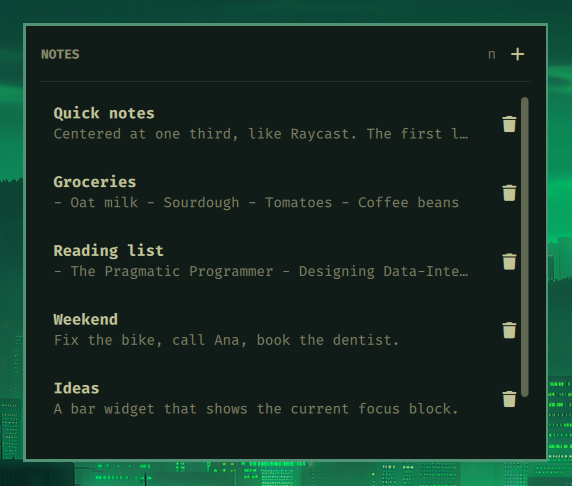
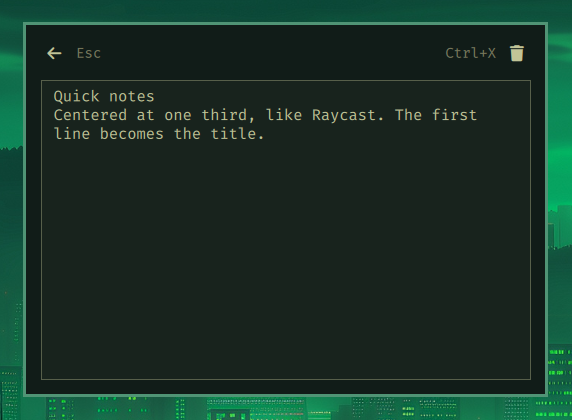
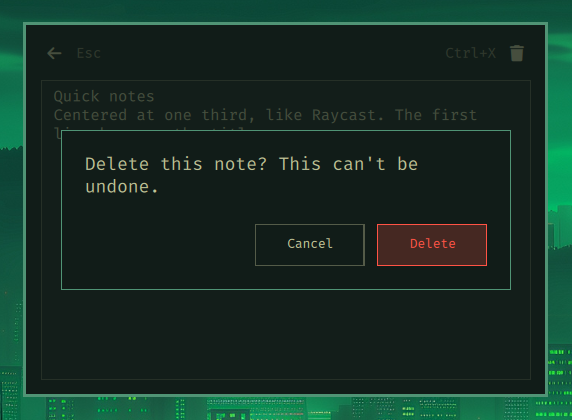

# Quick Notes

A keyboard-first notes panel for the Omarchy bar. One keybinding opens a
centered panel. The first line of each note becomes its title.



## Features

- A centered panel, placed one third of the way down the screen.
- Plain-text notes that save as you type.
- The first line of a note is its title. The rest of the note is the preview
  in the list.
- A scrollable list that follows the keyboard cursor.
- The panel remembers the open note, the current view, and the caret
  position between opens.
- Keyboard control for every action, including the delete confirmation.

## Install

```sh
omarchy plugin add https://github.com/msegoviadev/omarchy-quick-notes.git --enable
```

Add a keybinding in `~/.config/hypr/bindings.lua`:

```lua
o.bind("SUPER + ALT + N", "Quick notes", "omarchy-shell shell toggle quick-notes '{}'")
```

Reload Hyprland with `hyprctl reload`. The plugin also adds a note icon to
the bar.

## Usage

Press the keybinding to open or close the panel. The panel opens on the same
note and caret position that you left.

- `n` or `Ctrl+N` creates a note.
- `j`/`k` or the arrow keys move through the list.
- `Enter` opens the selected note.
- `Esc` returns to the list from a note, then closes the panel.
- `Ctrl+S` saves immediately. Typing also saves automatically.
- `Ctrl+X` deletes the note that is open.

The + button in the header creates a note with the mouse. The keyboard
cursor never moves onto it.

### Editor

The editor has no separate title field. Write the title on the first line.



### Delete confirmation

The confirmation dialog selects Delete by default. Use `h`/`l` or the arrow
keys to choose Cancel or Delete. Press `Enter` to confirm, or press `Esc` to
cancel.



### Keyboard reference

| Key | Action |
| --- | --- |
| `j` / `k`, arrows | Move through the list |
| `Enter` | Open the selected note |
| `n` | Create a note |
| `x` | Delete the selected note |
| `Esc` | Return to the list, then close the panel |
| `Ctrl+N` | Create a note from anywhere |
| `Ctrl+S` | Save now |
| `Ctrl+X` | Delete the open note |
| `h` / `l` | Choose a button in the delete dialog |

## Storage

Quick Notes stores its notes in:

```
~/.local/state/omarchy/plugins/quick-notes/notes.json
```

Every save writes the previous revision to `notes.json.bak`. The plugin reads
the notes file before it writes notes, so a restart cannot overwrite the notes
with an empty list.

The limits are 500 notes, 20,000 characters per body, and a 12 MiB file. The
plugin rejects an oversized file instead of loading it.

## Remove

```sh
omarchy plugin remove quick-notes
```

Remove the keybinding line from `~/.config/hypr/bindings.lua` after you remove
the plugin. The notes stay in the state directory until you delete them.

## Credits

Based on [omarchy-quick-notes](https://github.com/TibeDev/omarchy-quick-notes)
by TibeDev. MIT licensed.
